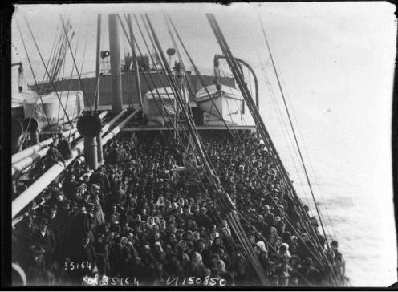
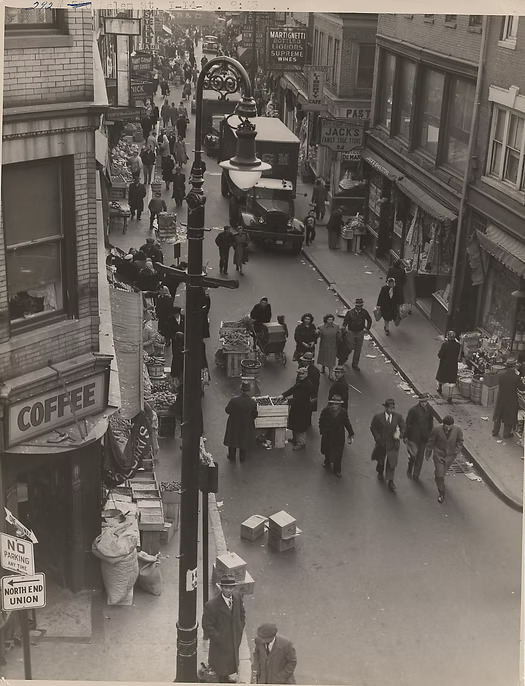



# The Immigrants who Made Boston's North End What it is Today

*How tightly immigrants from Italy were packed on immigration ships with the dream of finding a better life in America*[^1]

[^1]: (Italian-Americans: The History of Immigration to America, 2017)

## North End Migration Patterns

<iframe src="map/" width="100%" height="520"
  style="border:1px solid #ccc; border-radius:8px;"></iframe>

## The Lasting Influence of Immigration on Boston’s North End

[Read the essay](essay.html)

*The bustling streets of Little Italy*[^2]

[^2]: (Margareth, 2021)
